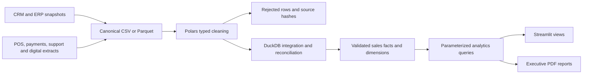

# Architecture and capacity

## Local implementation

The canonical input contract is the boundary between vendor extraction and the platform. Every run requires a complete, resolved snapshot with stable IDs. There is no fuzzy matching of personal identifiers. CRM's `customer_id` is the governed identity key across systems. Production feeds should resolve source identity in a restricted identity service before these extracts are produced.

Polars scans CSV/Parquet lazily, casts values with explicit null detection, trims strings, normalizes country codes and substitutes `Unknown` for missing loyalty tier. Invalid records go to separate Parquet files. Exact duplicate records collapse. Two different valid rows with the same source key fail the build because the input lacks an authoritative update timestamp.

DuckDB joins dimensions and payments, checks campaign-month consistency and rejects orphan facts. Only completed, settled and reconciled orders enter `fact_sales`. DECIMAL(18,2) warehouse measures avoid floating-point drift in financial totals. `daily_sales` provides a preaggregation for future query optimization. The default dashboard queries the fact table for flexible distinct-customer metrics.

Each build has an immutable run directory. The new database is closed and atomically replaces `warehouse.duckdb` only after successful checks. A failed run leaves the previous published warehouse intact. Windows may reject replacement while another process holds the database open; retry during a controlled refresh window. Dashboard queries open short-lived read-only connections and do not retain a shared write connection.

## Warehouse grain

| Object | Grain | Main relationship |
| --- | --- | --- |
| `crm_customers` | Customer | `customer_id` identity |
| `erp_products` | Product | `product_id` |
| `erp_stores` | Branch | `store_id` |
| `pos_orders` | Order, including status | Customer, product, branch, campaign |
| `fact_sales` | Valid completed order | Enriched dimensional measures |
| `payment_orders` | One payment summary per order | `order_id` |
| `marketing_campaigns` | Campaign in one month | `campaign_id` |
| `fact_sessions` | One web/app session | Source prefix + session ID |
| `support_tickets` | Ticket | Customer |
| `email_campaigns`, `social_campaigns` | Campaign aggregate | Campaign |
| `daily_sales` | Date, country, channel, category | Additive summaries |
| `data_quality` | Source per current run | Row counts and file hashes |
| `metadata` | One current run | Source coverage and classification |

Dimension joins are many-to-one. Aggregation of source campaign metrics happens independently of sales before any combination to prevent fan-out. Retention uses distinct sets rather than averaging subgroup rates.

## Path to 500 million records

The case study's record count is a nonfunctional target, not a verified capability of this local demo. The default generation utility holds synthetic frames in memory and is deliberately bounded to demonstration sizes.

For enterprise deployment:

1. Land source deltas in object storage with source version, ingestion timestamp, event time, immutable batch ID and an explicit delete/correction policy.
2. Partition order and event Parquet by event month and country. Keep row groups suitable for predicate pushdown. Compact small files and track snapshots in an Iceberg/Delta catalog or equivalent governed table layer.
3. Add incremental merge semantics, watermarks, late-arriving corrections, slowly changing dimensions, event-time refund facts and source-key crosswalks. The current pipeline performs a full rebuild.
4. Materialize daily/monthly dimensional aggregates and buyer sets in a scheduled warehouse pipeline. Distinct counts and cohorts need exact or explicitly approximate mergeable measures; do not sum overlapping daily unique counts.
5. Serve a read-only analytics database or managed warehouse behind an API/cache and OIDC gateway. Keep customer-level access policy at the query layer. The current app has role gates but no region-level row security.
6. Set memory/spill quotas, worker limits, retry policy, orchestration locking, freshness alerts and disaster-recovery targets. Encrypt storage and transport, isolate identity, and audit access outside the application.

## Capacity acceptance plan

Generate or obtain authorized 1M, 10M, 100M and 500M record benchmarks with realistic skew, cardinality, correction rates and wide rows. Record hardware, disk bandwidth, row groups, cold/warm caches and concurrency. Measure import throughput, peak RSS, spill usage, duplicate and FK-check time, refresh duration and read latency at 1/10/50 concurrent viewers. A proposed initial goal is p95 under 2 seconds for summary views and under 5 seconds for profile drill-downs. These are proposed acceptance thresholds, not observed results. Block promotion if accounting reconciliation, source quality or coverage fails even when latency meets target.

Use `scripts/benchmark.py` for a small query benchmark on an existing warehouse. It reports actual volume and timings; it does not extrapolate enterprise capacity.

